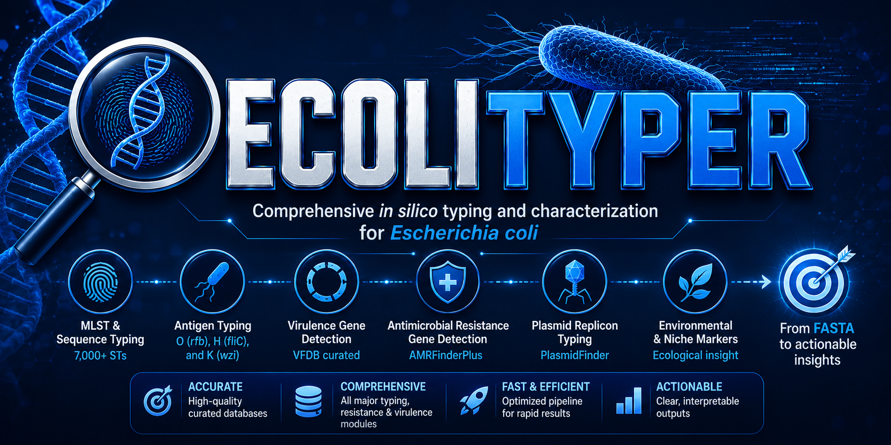

<p align="center">
  
</p>

<div align="center">

# 🧬 EcoliTyper

### **A species-optimized computational pipeline for comprehensive genotyping and surveillance of *Escherichia coli***

#### **Complete *E. coli* genomic analysis in minutes — not hours**

[](CODE_OF_CONDUCT.md)
[](https://opensource.org/licenses/MIT)
[](https://www.python.org/downloads/)
[](https://github.com/bbeckley-hub/EcoliTyper)
[](https://github.com/bbeckley-hub/EcoliTyper/stargazers)
[](https://hub.docker.com/r/bbeckleyhub/ecolityper)
[](https://hub.docker.com/r/bbeckleyhub/ecolityper)
[](https://hub.docker.com/r/bbeckleyhub/ecolityper)
[](https://doi.org/10.1186/s12859-026-06529-6)

[](LICENSE)
[](https://github.com/bbeckley-hub/EcoliTyper/issues)

[](#)
[](#)
[](https://anaconda.org/bioconda/ecolityper)

[](https://github.com/bbeckley-hub/EcoliTyper)
[](https://github.com/bbeckley-hub/EcoliTyper)
[](https://github.com/bbeckley-hub/EcoliTyper)
[](https://github.com/ellerbrock/open-source-badges/)
[](https://github.com/bbeckley-hub)

[](https://bbeckley-hub.github.io/EcoliTyper)
[](https://www.sphinx-doc.org/)
[](https://github.com/bbeckley-hub/EcoliTyper/commits)
[](https://github.com/bbeckley-hub/EcoliTyper/graphs/contributors)
[](https://github.com/PyCQA/bandit)

[](https://github.com/psf/black)
[](https://pycqa.github.io/isort/)
[](https://github.com/astral-sh/ruff)
[](https://github.com/pre-commit/pre-commit)
[](https://github.com/bbeckley-hub/EcoliTyper/actions)
[](https://github.com/bbeckley-hub/EcoliTyper/tests)
[](https://gitpod.io/#https://github.com/bbeckley-hub/EcoliTyper)

[](https://github.com/bbeckley-hub/EcoliTyper#performance-benchmarks)
[](https://bbeckley-hub.github.io/eclipse/)
[](https://github.com/bbeckley-hub/EcoliTyper)
[](https://github.com/bbeckley-hub/EcoliTyper)
[](https://github.com/bbeckley-hub/EcoliTyper#ai-integration-guide)

[](https://docs.conda.io/en/latest/)
[](https://bbeckley-hub.github.io/EcoliTyper/)

[](https://scholar.google.com/citations?user=CYNOsqIAAAAJ&hl=en)
[](https://www.linkedin.com/in/brown-beckley-190315319)


[](https://git.io/streak-stats)

**Two ways to use EcoliTyper:**
🖥️ **Command-line tool** for high-throughput local analysis
🌐 **ECLIPSE Browser** for selecting from 431,592 public *E. coli* genomes — [https://bbeckley-hub.github.io/eclipse/](https://bbeckley-hub.github.io/eclipse/)

</div>

---

## 🎉 **What's New in v1.4.0 — MGE Profiling, Report Levels, and ECLIPSE**

We built v1.4.0 to answer three questions that came up again and again: *"how did these genes get here?"*, *"how do I manage disk on 1,000 genomes?"*, and *"how do I pick the right public genomes to compare against?"*.

### 🧬 **1. MGE Profiling — Because Resistance Needs a Postal Address**

Every genome now gets full mobile genetic element profiling through the manually curated [mobileOG-db](https://github.com/clb21565/mobileOG-db). Twelve columns of per-hit detail — Rank, mobileOG_ID, Gene, Contig, Start, Stop, Strand, Major_Category, Minor_Category, Percent_Identity, Align_Over_Qlen, Coverage_Percent — parsed, aggregated per sample, and rendered in a dedicated interactive tab.

**Why this changes interpretation:**

- **Resistance dissemination:** A plasmid-associated gene cluster appearing in two unrelated STs is a smoking gun for horizontal transfer.
- **Virulence acquisition:** Shiga toxin genes and other virulence modules are frequently prophage-borne.
- **Persistent infections:** Strong stability systems let plasmids survive without antibiotic selection.
- **Outlier detection:** An isolate with double the cohort's MGE load is either something new or something wrong. Either way, worth a closer look.

### 📉 **2. Report-Level Disk Management**

New `--report-level {final,summary,full}` flag. On a 1,000-genome cohort, `final` keeps the run under ~80 MB. `summary` (default) retains batch summaries. `full` keeps everything. A safety check prevents pruning if the final report directory is missing or empty — the run never self-destructs.

### 🌐 **3. ECLIPSE — Browser for 431,592 Public *E. coli* Genomes**

We are proud to introduce [ECLIPSE (E. coli Library for Integrated Pathogen Surveillance and Epidemiology)](https://bbeckley-hub.github.io/eclipse/), a free, interactive, browser-based database that solves the biggest bottleneck in *E. coli* genomics: **retrieving the exact subset of genomes you need.**

**The problem:** You want all ST131 phylogroup B2 bloodstream isolates from the United Kingdom between 2010 and 2020, carrying CTX-M-15 and *iroN*. In existing repositories, this means downloading multiple compressed tables, writing custom scripts to cross-reference typing, gene presence, and metadata, and manually merging files. It is slow, error-prone, and requires coding skills that many clinical and public health researchers do not have.

**The solution:** ECLIPSE puts the entire public *E. coli* repository in your browser. With **431,592 unique genomes** integrated across typing, gene annotation, and epidemiological modules, you can filter by MLST, phylogroup, serotype, CH type, pathotype, AMR genes, virulence factors, country, isolation source, host, and collection year — all in real time.

**Click. Filter. Export.** The result is a plain-text accession list, ready for:
`datasets download genome accession --inputfile list.txt`

**ECLIPSE by the numbers:**

| Metric | Value |
|---|---|
| **Genomes** | **431,592** unique *E. coli* accessions |
| **Countries** | 173 |
| **MLST sequence types** | 309 |
| **Phylogroups** | 8 (A, B1, B2, C, D, E, F, G) |
| **Serotypes** | 372 |
| **CH types** | 267 |
| **Host species** | 1,173 |
| **Source categories** | 2,351 |
| **Collection years** | 1900–2026 |

> **No installation. No account. No API key.** ECLIPSE runs entirely over HTTPS on GitHub Pages, making it immune to server crashes, API rate limits, and funding deprecation.

**[🚀 Explore ECLIPSE Now →](https://bbeckley-hub.github.io/eclipse/)**

### 🎛️ **4. New MLST Database Management**

Mirror of the StaphScope workflow:

- **`--pull-mlst-db`** — downloads a pre-built *E. coli* scheme from GitHub (no API key, ~2 minutes)
- **`--update-mlst-db`** — fetches the latest alleles directly from PubMLST (API key required, 10–20 minutes)

### 🛡️ **5. Species Gate — Downstream Only Runs on Confirmed *E. coli***

FASTA QC produces a species-confirmation gate (`FASTA_QC_species_passed.txt`). Only samples that pass the *E. coli*/*Shigella* species check flow into downstream modules. Non-*E. coli* samples are excluded with a logged warning — no false-positive MLST, serotype, or AMR calls.

### 📝 **6. Complete Subprocess Logging**

`ecolityper_run.log` now captures full stdout and stderr from every module — no truncation. When a module fails, its complete output is echoed to the console with the exact traceback.

### 🐳 **7. Docker Image Overhaul**

Rebuilt on `mambaorg/micromamba` with a BuildKit cache mount. Compressed size drops from 5+ GB to ~1.8 GB. Every database — AMRFinderPlus, MLST Achtman, ABRicate, mobileOG-db — is baked in during build, so first-run network calls are zero. Code-only rebuilds finish in ~30 seconds.

---

## 🎯 **Overview**

**EcoliTyper** is an automated, locally-executable computational pipeline designed specifically for comprehensive *Escherichia coli* genomic surveillance. It eliminates workflow fragmentation by integrating **ten analysis modules** into a single, cohesive workflow.

### The Problem
- **Fragmented Bioinformatics:** Traditional *E. coli* analysis requires 10+ separate tools with conflicting dependencies.
- **Resource Barriers:** Web-based services need constant internet and raise data privacy concerns.
- **Time Constraints:** Generalist platforms take hours; outbreaks need answers in minutes.
- **Interpretation Challenges:** Raw data without epidemiological context limits actionable insights.
- **Disk Explosion:** Intermediate files balloon to tens of gigabytes on large cohorts.

### Our Solution
EcoliTyper delivers:
- ✅ **Single-command installation** via Conda, Docker, or Singularity
- ✅ **2–7 minute complete analysis** per genome
- ✅ **100% local execution** with data privacy
- ✅ **Interactive HTML reports** with epidemiological context
- ✅ **Automated pathotype classification** (STEC, EPEC, EHEC, EAEC, ETEC, DAEC, EIEC)
- ✅ **Full mobile element profiling** via mobileOG-db
- ✅ **Species gate** — only confirmed *E. coli* runs downstream
- ✅ **Report-level disk control** — from ~80 MB per 1,000 genomes upward

**Perfect for:** Clinical labs, outbreak investigations, research studies, and public health surveillance.

---

## ✨ **Key Features**

### 🔬 **Core Analytical Modules**

| Module | 🎯 Purpose | 📊 Key Outputs | ⚡ Speed |
|--------|------------|----------------|----------|
| **FASTA QC** | Assembly stats + fastANI species confirmation | N50, GC%, contig counts, ANI %, species gate | <30 sec |
| **MLST** | Achtman seven-gene sequence typing | ST, allele profile | <1 min |
| **Serotyping** | O and H antigen determination | O type, H type, serotype, confidence | <1 min |
| **CH Typing** | *fumC* / *fimH* allele typing | CH type, both alleles, identity + coverage | 1–2 min |
| **Phylogrouping** | Clermont 2013 scheme | Phylogroup A–G | <30 sec |
| **AMRFinderPlus** | NCBI resistance + mutation detection | AMR genes, point mutations, risk class | 2–3 min |
| **ABRicate** | Ten-database resistance, virulence, plasmid screening | Per-database hit tables with coverage + identity | 3–4 min |
| **MGE Profiling** | mobileOG-db mobile element signatures | Twelve-column per-hit detail, category totals | 2–3 min |
| **Gene-centric Report** | Gene tables with dynamic grouping by typing | Interactive HTML with all genes + genome lists | <1 min |
| **Sample-centric Report** | Per-isolate lazy-loaded boxes | Interactive HTML with per-isolate tables + filters | <1 min |
| **Comprehensive Report** | Master typing table | TSV, HTML, JSON consolidated deliverable | <1 min |
| **Visualization** | Plotly dashboard + static exports | Interactive HTML, PNG, PDF, SVG | 1–2 min |

---

### 📊 **Sample Integrated Reports**

Every report in one place — browse, search, preview, and open any EcoliTyper output. **[Open the Live Report Hub →](https://bbeckley-hub.github.io/EcoliTyper/)**

| Report Type | What it shows | Direct link |
|---|---|---|
| **📄 Comprehensive Report** | Master typing table — MLST, serotype, phylogroup, CH type, pathotype | [](https://bbeckley-hub.github.io/EcoliTyper/ecolityper_comprehensive_report.html) |
| **🧬 Gene-Centric Report** | Every AMR / virulence / BACMET / plasmid / mutation / MGE entry, with all genomes that carry it | [](https://bbeckley-hub.github.io/EcoliTyper/genius_ecoli_ultimate_gene_centric_report.html) |
| **📋 Sample-Centric Report** | Per-isolate lazy-loaded boxes with full Compare & Cluster tab | [](https://bbeckley-hub.github.io/EcoliTyper/genius_ecoli_ultimate_sample_centric_report.html) |
| **📈 Interactive Dashboard** | Plotly dashboard — Overview, Typing, Pathotype, QC, AMR, Virulence, MGE, Alerts, Compare | [](https://bbeckley-hub.github.io/EcoliTyper/ecolityper_dashboard.html) |
| **🔬 MLST Summary** | Sequence types + allele profiles across your cohort | [](https://bbeckley-hub.github.io/EcoliTyper/mlst_summary.html) |
| **🏷️ Serotype Summary** | O and H antigens + confidence | [](https://bbeckley-hub.github.io/EcoliTyper/serotype_analysis_report.html) |
| **🧬 CHTyper Summary** | *fumC* / *fimH* alleles + CH types | [](https://bbeckley-hub.github.io/EcoliTyper/chtyper_results.html) |
| **🌳 Phylogroup Summary** | Clermont phylogroups A–G | [](https://bbeckley-hub.github.io/EcoliTyper/phylogrouping_results.html) |
| **📏 FASTA QC** | N50 / GC / contigs + fastANI species confirmation | [](https://bbeckley-hub.github.io/EcoliTyper/FASTA_QC_summary.html) |
| **📱 MGE Profile** | mobileOG-db counts across functional categories | [](https://bbeckley-hub.github.io/EcoliTyper/ecolityper_mge_summary.html) |

> **Note:** Reports may take a few seconds to load. For the best experience, download the HTML files and open them locally — every report is fully self-contained and offline-capable.

---

### 🦠 **Pathotype-Specific Innovations**
- **Automated Pathotype Classification**: Marker-based STEC / EPEC / EHEC / EAEC / ETEC / DAEC / EIEC prediction.
- **Hybrid Support**: Multi-pathotype genomes (e.g. *EHEC-EAEC*) correctly labelled.
- **Clinical Gene Flagging**: Automatic highlighting of *stx*, *eae*, *ipaH*, *LT*, *ST*, and other critical determinants.
- **Risk Assessment**: Categorizes genes as 'Critical Risk' (e.g. *mcr-1*, *blaNDM*, *blaKPC*) or 'High Risk'.
- **Cross-Genome Pattern Discovery**: Summarizes gene frequencies across entire sample sets.
- **Cluster Detection**: Union-find algorithm on typing data to auto-detect transmission clusters.
- **Curated Lineage Database**: High-risk clones (ST131, ST1193, ST95, ST73, ST69) with geographical distribution.

---

## 🔥 **Feature Deep-Dives**

<details>
<summary><b>⚖️ The Compare Tab — Because "I Think They're the Same Bug" Isn't Good Enough (Click to expand)</b></summary>
<br>

Let's be honest about how most outbreak investigations actually happen. Someone has two genomes. They run typing on both. Then they open two HTML files, scroll up and down, mentally diff the MLST, the serotype, the phylogroup, the CH type, the AMR genes, the virulence genes, the plasmid replicons… and at some point they say *"yeah, I think they're the same."*

That is not a methodology. That's an eyeball.

**The Compare tab replaces the eyeball.** Pick any two isolates, click a button, and get:

1. **A verdict banner** — 🔴 near-identical (≥95% similarity), 🟠 high (≥85%), 🟡 moderate (≥60%), 🔵 distinct
2. **A similarity gauge** — an animated colored ring showing overall match percentage
3. **A typing table** — every field side by side, green pill for match, red pill for diff
4. **Gene content split three ways** — 🟢 shared, 🔵 only in A, 🟣 only in B — per category (AMR, Virulence, BACMET, Plasmids, Mutations, MGE), with proportional bars and expandable full lists

**Why this matters for research:**
- **Outbreak confirmation:** Two isolates from the same ward with identical MLST + serotype + phylogroup + CH type are very likely a transmission pair. Your infection control team will actually do something about that.
- **Discordance analysis:** An ancestor and a resistant descendant look identical in *every* field except one — and that one field tells you which mobile element moved.
- **QC checks:** Two genomes from the same sequencing run that come back as "identical" — one is probably a duplicate. Better to catch that now than publish it.
- **Teaching:** If you have ever tried to explain "why isn't this the same strain?" to a clinician, showing them the Compare tab takes 30 seconds and produces actual agreement.

And when you have more than two samples? **Switch to Cluster Mode.** Automatic pairwise similarity matrix, colour-coded heatmap, automatic cluster detection (union-find algorithm on your own typing data), and a per-cluster summary card showing mean intra-cluster similarity. It's the difference between "we have 40 isolates" and "we have 40 isolates in 6 clusters, 3 of which are outbreak-suspicious."

**A caveat we're proud to state openly:** "Identical typing = transmission pair" is a **hypothesis generator, not a confirmation**. Two isolates can share MLST + serotype + phylogroup + CH type and still be unrelated — those markers evolve too slowly for hospital-level resolution. The gold standard remains core-genome SNP distance, which EcoliTyper doesn't compute (and shouldn't, at this scope). We use the phrase *"possible transmission pair"* deliberately. If we ever lose that hedge, shout at us.
</details>

<details>
<summary><b>🦠 The Virulence Expander — Because 400 Gene Names Won't Fit in a Cell (Click to expand)</b></summary>
<br>

Before the sample overview gained an expander, if you wanted to see which virulence genes a specific isolate carried, you had to open the Virulence tab, find the row for each gene, and mentally tick off which genomes were listed. For a cohort of 40 samples, this was a job you did once and never wanted to do again.

Now: **Sample Overview** has a **Virulence column with a click-to-expand count**. Click the number, and a panel slides open showing every VFDB and EcoLi_VF gene that isolate carries — colour-coded, in the same visual language as everything else in the report.

**Why this is more than cosmetic:**
- **Case-by-case drill-down:** When a clinician asks *"what does this isolate actually carry?"*, you have one answer in one place.
- **Teaching tool:** Because explaining Shiga toxin + intimin + enterohaemolysin is a lot easier when you can expand and show the gene list in real time.
- **Screening:** Sort by the count column and the top five highest-virulence isolates float to the top. Useful for prioritising further work.
- **No page reload:** This is a `details/summary` element. The whole report stays one file. Offline. No server. No JavaScript framework. Just HTML.
</details>

<details>
<summary><b>📱 The MGE Tab — Where Resistance Gets a Postal Address (Click to expand)</b></summary>
<br>

You have AMR genes. You have virulence genes. You know *what* a genome carries. But *how did it get there?*

**Mobile genetic elements are the answer.** Plasmids, prophages, transposons, integrative conjugative elements — these are the physical vehicles that shuttle resistance and virulence genes between unrelated bacteria. If you don't understand the MGE landscape, you're looking at the mail without ever seeing the postal system.

**What the MGE tab gives you:**
- **Per-sample counts** across ten functional categories (Integrase, Transfer, Stability, Phage, Replication, IS-associated, ICE-associated, Plasmid-associated, Phage-associated, and Key MGE-signatures).
- **Aggregate profiles by typing** — mean MGE load per ST, per serotype, per phylogroup, per CH type. High MGE burden in one lineage but not another is a real signal.
- **Top-N views** — the five isolates with the most IS-associated proteins, plasmid proteins, or high-confidence MGE signatures.
- **Education cards** — because "what is an IS element and why do I care?" is a question that deserves a proper answer.

**What it helps with:**
- **Resistance dissemination:** A plasmid-associated gene cluster in two unrelated STs is a smoking gun for horizontal transfer.
- **Virulence acquisition:** Shiga toxin genes are frequently prophage-borne.
- **Persistent infections:** Strong stability systems let plasmids survive without selection.
- **Outlier detection:** An isolate with 2× the cohort's MGE load is either something new, or something broken. Either way you should look.

**A word of honesty:** mobileOG-db counts protein *signatures*, not reconstructed elements. Multiple proteins from the same element produce multiple hits, and some categories also fire on chromosomal genes. That's why we use the word *"signatures"* everywhere. If you want element-level claims, you need co-localization analysis — which is a bioinformatics project, not a column in a dashboard.
</details>

<details>
<summary><b>💊 The Pathotype Tab — Because "E. coli" Is Not a Diagnosis (Click to expand)</b></summary>
<br>

*E. coli* is a species, not a disease. The same organism can be a harmless gut commensal or a lethal enterohaemorrhagic pathogen, and the difference is a specific combination of virulence genes. EcoliTyper classifies each genome against the seven major diarrhoeagenic pathotypes:

| Pathotype | Marker logic | Clinical context |
|---|---|---|
| **STEC** | *stx1* or *stx2* present, *eae* absent | Shiga toxin-producing — haemorrhagic colitis and HUS |
| **EPEC** | *eae* or *bfpA* present, *stx* absent | Enteropathogenic — infantile diarrhoea |
| **EHEC** | *stx* and *eae* both present | Enterohaemorrhagic — bloody diarrhoea, HUS |
| **EAEC** | *aggR*, *aaiC*, or *aatA* present | Enteroaggregative — persistent diarrhoea |
| **ETEC** | *lt* or *sta1* present | Enterotoxigenic — traveller's diarrhoea |
| **DAEC** | *afaC* or *afaE* present | Diffusely adherent — paediatric diarrhoea |
| **EIEC** | *ipaH* present | Enteroinvasive — dysentery-like illness |
| **none** | No diarrhoeagenic markers detected | No pathotype predicted |

Genomes can carry multiple labels joined by a dash (*EHEC-EAEC* hybrid patterns exist).

**Interpretation notes worth stating openly:**
- Pathotype is a computational prediction, not a clinical diagnosis. Confirm with phenotype.
- Markers are inferred at the ABRicate identity and coverage thresholds used for the run (default 80/80).
- A gene present but below threshold will not be counted — raising thresholds can silently reclassify a genome.
- Upstream and downstream context such as LEE island intactness is not evaluated; only marker presence.

**Why the tab matters:** because when an outbreak report says "STEC detected in 3 of 40 isolates", your infection control team needs to know *which three*, *which serotype*, and *which other genes they carry*. The Pathotype tab answers all three in one screen.
</details>

<details>
<summary><b>🛡️ The Species Gate — Because Klebsiella Should Not Be Typed as E. coli (Click to expand)</b></summary>
<br>

A mislabelled *Klebsiella* assembly run through an *E. coli* serotyper will produce a confident, wrong answer. A *Salmonella* genome run through an *E. coli* MLST scheme will either fail or return a spuriously close ST.

EcoliTyper prevents both. FASTA QC performs a fastANI species check against four reference genomes (*E. coli* K-12, *Shigella flexneri*, *Klebsiella pneumoniae*, *Salmonella enterica*) and writes `FASTA_QC_species_passed.txt`. Only samples that pass flow downstream. Excluded samples are listed individually in the log with the reason.

*Shigella* is treated as *E. coli* for species confirmation, which is the correct genomic stance — *Shigella* is nested within the *E. coli* species complex.

**Why this is important at scale:** On a 500-genome surveillance run, it is not unusual to find 2–5% mislabelled or contaminated entries. Without a species gate, every downstream analysis silently inherits those errors. With it, you get a clean downstream dataset and an explicit audit trail of what was excluded and why.
</details>

<details>
<summary><b>📉 Report Levels — Because Disk Is Not Infinite (Click to expand)</b></summary>
<br>

EcoliTyper produces substantial intermediate output by default. On a 1,000-genome cohort that adds up fast. The `--report-level` flag gives explicit control:

| Level | What is kept | Approximate size per 1,000 genomes |
|---|---|---|
| `final` | Only `EcoliTyper_final_report/` — comprehensive report, gene-centric HTML, sample-centric HTML | ~80 MB |
| `summary` (default) | Final report plus batch TSVs, HTMLs, and JSONs in each module folder; per-sample folders removed | ~500 MB |
| `full` | Everything including per-sample HTMLs and raw files | ~15 GB |

Under the hood, `final` deletes every module directory after consolidation, `summary` deletes only per-sample subdirectories, and `full` keeps everything. A safety check prevents pruning if `EcoliTyper_final_report/` is missing or empty, so the run never self-destructs.

**Rule of thumb:** use `final` for archival and very large cohorts, `summary` for normal day-to-day work, and `full` only when debugging or when you have specific downstream per-sample analysis planned.
</details>

<details>
<summary><b>🌐 The MLST Database — Pull Once, Refresh from PubMLST Anytime (Click to expand)</b></summary>
<br>

EcoliTyper ships with a pre-built Achtman MLST database, but you can replace it at any time.

**`ecolityper --pull-mlst-db`** downloads a pre-built *E. coli* scheme (Achtman plus legacy) from GitHub. No API key, roughly two minutes. Recommended for first-time users, offline environments, and automated CI where determinism matters.

**`ecolityper --update-mlst-db`** fetches the latest alleles directly from PubMLST, including novel STs and recently described alleles. Ten to twenty minutes depending on network. Requires a one-time API key.

**One-time PubMLST API key setup:**

1. Register at https://pubmlst.org/site-accounts.
2. Generate an API key from your profile under "API keys".
3. Run `mlstdb connect --db pubmlst --api-key` and paste the key when prompted.
4. From that point, `ecolityper --update-mlst-db` uses the stored key automatically.

Both commands honour `$ECOLITYPER_MLST_DB` and `$ECOLITYPER_MLST_MODULE_PATH`, which matters in Docker, Apptainer, and shared conda environments where the packaged module directory may be read-only.

**When to use which:**

| Situation | Command |
|---|---|
| First-time install | `--pull-mlst-db` |
| Offline / no API key | `--pull-mlst-db` |
| Want the newest alleles | `--update-mlst-db` |
| Novel ST or scheme change | `--update-mlst-db` |
| Automated CI/CD | `--pull-mlst-db` (deterministic) |
</details>

---

## 🌐 **ECLIPSE — the Browser for 431,592 Public *E. coli* Genomes**

**ECLIPSE** (E. coli Library for Integrated Pathogen Surveillance and Epidemiology) is a free, browser-based companion to EcoliTyper. It solves the retrieval problem that dominates genomic epidemiology: getting the exact subset of public genomes you need, without writing a single line of code.

**[🚀 Explore ECLIPSE →](https://bbeckley-hub.github.io/eclipse/)**

### What ECLIPSE holds

| Metric | Value |
|---|---|
| Genomes | 431,592 public *E. coli* accessions |
| Countries | 173 |
| MLST sequence types | 309 |
| Phylogroups | 8 |
| Serotypes | 372 |
| CH types | 267 |
| Host species | 1,173 |
| Source categories | 2,351 |
| Collection years | 1900–2026 |

### How it works

1. Pick a typing module (MLST, phylogroups, serotypes, CHTyper, pathotypes, AMR genes, virulence factors, MGE) or the master table.
2. Stack filters — genotype plus geography plus source plus year. Example: ST131, phylogroup B2, United Kingdom, blood, 2010–2020, CTX-M-15.
3. Export a plain-text accession list with one click.
4. Feed the list to NCBI: `datasets download genome accession --inputfile list.txt`.

No installation, no account, no API key. ECLIPSE runs entirely over HTTPS on GitHub Pages, which makes it immune to server outages, rate limits, and funding deprecation.

### Part of the ARGUS family

ECLIPSE is one of seven species-optimised browsers in the **ARGUS** (Antimicrobial Resistance Genomic Unified Surveillance) family. Each is built on the same architecture and the same typing pipelines:

| Species | Browser |
|---|---|
| *Staphylococcus aureus* | [SAURUS](https://bbeckley-hub.github.io/saurus/) |
| *Escherichia coli* | **ECLIPSE** |
| *Acinetobacter baumannii* | ABYSS |
| *Klebsiella pneumoniae* | KLEOS |
| *Pseudomonas aeruginosa* | PSEUDA |
| *Enterococcus faecium* | EMPIRE |
| *Enterobacter* spp. | ENTROPY |

### Citing ECLIPSE

If you use ECLIPSE in your research, cite the pipeline that produced its typing annotations:

> Beckley B, Amarh V. EcoliTyper: a species-optimized computational pipeline for comprehensive genotyping and surveillance of *Escherichia coli*. *BMC Bioinformatics*. 2026;27:182. doi:[10.1186/s12859-026-06529-6](https://doi.org/10.1186/s12859-026-06529-6)

Metadata derives from NCBI BioSample records (country, isolation source, host, collection date). Please also cite the specific downstream tools you used — mlst, ezClermont, SerotypeFinder, CHTyper, ABRicate — full details in the citation section.

---

## ⚡ **Quick Start (CLI)**

### Install in 60 seconds
```bash
# Method 1: Conda (Recommended)
conda create -n ecolityper -c conda-forge -c bioconda ecolityper -y
conda activate ecolityper

# Method 2: From source
git clone https://github.com/bbeckley-hub/EcoliTyper.git
cd EcoliTyper
conda env create -f environment.yml
conda activate ecolityper
pip install -e .
```

### Run your first analysis
```bash
# Single genome
ecolityper -i genome.fasta -o results/

# Batch processing (24 genomes)
ecolityper -i "*.fna" -o batch_results --threads 16
# Complete in ~14 minutes! 🎉
```

### Update Databases (Recommended)
```bash
# ABRicate databases
abricate --setupdb

# AMR database
ecolityper --update-amr-db

# MLST database
ecolityper --pull-mlst-db
```

### Common recipes

```bash
# Minimal disk footprint for 1,000-genome cohorts
ecolityper -i "*.fna" -o results --report-level final --threads 16

# Skip MGE and visualization for fast typing-only runs
ecolityper -i "*.fna" -o results --skip-mge --skip-visualization

# Strict AMR thresholds (0.95 identity, 0.90 coverage) without mutations
ecolityper -i "*.fna" -o results \
  --amr-min-identity 0.95 --amr-min-coverage 0.90 --skip-amr-mutations

# Strict ABRicate thresholds (90 identity, 85 coverage)
ecolityper -i "*.fna" -o results --abricate-minid 90 --abricate-mincov 85

# Database maintenance
ecolityper --update-amr-db           # incremental
ecolityper --force-update-amr-db     # full overwrite
ecolityper --pull-mlst-db            # quick start from GitHub
ecolityper --update-mlst-db          # refresh from PubMLST (API key)
```

---

## 🐳 **Docker & Singularity Usage – avoid the padlock 🔓**

Docker and Singularity users get **everything pre-installed** — no first-run database setup, no `--pull-mlst-db`, no `--update-amr-db`, no `abricate --setupdb`. Every database (MLST scheme, AMRFinderPlus, ABRicate DBs, mobileOG-db) and every tool (BLAST, DIAMOND, Prodigal, fastANI, ezClermont) is baked into the image. **Pull and run.**

> **Conda users:** you must run `ecolityper --pull-mlst-db` and `ecolityper --update-amr-db` once after install. Docker and Singularity users skip that entirely.

---

### 🐳 **Docker (laptops, workstations, cloud VMs)**

Docker runs containers as `root` by default, so files written to bind-mounted directories come out owned by `root:root`. **Fix: add `-u $(id -u):$(id -g)`.**

```bash
# Pull the image
docker pull bbeckleyhub/ecolityper:1.4.0

# Run (no padlock, no sudo chown)
docker run --rm \
  -u $(id -u):$(id -g) \
  -v $(pwd):/data \
  bbeckleyhub/ecolityper:1.4.0 \
  -i "/data/*.fna" -o /data/output -t 4
```

- `-u $(id -u):$(id -g)` → files owned by **you**
- `-v $(pwd):/data` → mounts your current dir as `/data` inside the container
- `-i "/data/*.fna"` → uses the **container path**, not your host path
- `-o /data/output` → lands at `./output/` on your host

<details>
<summary><b>Verify the image and open a debugging shell (Click to expand)</b></summary>

```bash
# Verify the container runs
docker run --rm bbeckleyhub/ecolityper:1.4.0 --help

# Interactive shell (for debugging)
docker run --rm -it bbeckleyhub/ecolityper:1.4.0 bash
```

**Image size:** ~1.8 GB compressed / ~7.8 GB on disk.
</details>

---

### 🔬 **Singularity / Apptainer (HPC clusters) — recommended for HPC**

**HPC users should use Singularity, not Docker.** HPC login and compute nodes don't run the Docker daemon; Singularity (or its successor Apptainer) is the standard. Same SIF format, rootless by default, and no UID juggling — it runs as your real user automatically.

<details>
<summary><b>1. Load the runtime (Click to expand)</b></summary>

Module names vary by cluster — check with `module avail`:

```bash
# Newer clusters — Apptainer
module load apptainer

# Older clusters — Singularity
module load containers/singularity/3.6.4

# Pulling the image ALSO needs mksquashfs from squashfs-tools
module load squashfs-tools/4.4

singularity --version   # or: apptainer --version
```
</details>

<details>
<summary><b>2. Pull the image (one-time, needs internet on login node) (Click to expand)</b></summary>

```bash
singularity pull ecolityper_1.4.0.sif docker://bbeckleyhub/ecolityper:1.4.0
```

Creates `ecolityper_1.4.0.sif` (~1.8 GB) in the current directory. **`squashfs-tools` is only needed for the pull, not for running.**
</details>

<details>
<summary><b>3. Run the pipeline (Click to expand)</b></summary>

```bash
singularity run --bind $(pwd):/data \
  ecolityper_1.4.0.sif \
  -i "/data/*.fna" -o /data/output -t 16
```

- `--bind $(pwd):/data` — HPC equivalent of Docker's `-v`
- **No `-u` needed** — Singularity runs as your real UID
- **No `-e HOME=` needed** — Singularity uses your real `$HOME`, so MLST and AMR caches persist between runs

> ⚠️ **Use `singularity run`, not `singularity exec`.** The image's entrypoint sets up `PATH` and `LD_LIBRARY_PATH` for the conda environment — `run` invokes it, `exec` skips it, which will break AMRFinderPlus.
</details>

<details>
<summary><b>4. SLURM job script (Click to expand)</b></summary>

```bash
#!/bin/bash
#SBATCH --job-name=ecolityper
#SBATCH --cpus-per-task=16
#SBATCH --mem=32G
#SBATCH --time=04:00:00
#SBATCH --output=ecolityper_%j.log

module load containers/singularity/3.6.4

cd $SLURM_SUBMIT_DIR

singularity run --bind $(pwd):/data \
  /path/to/ecolityper_1.4.0.sif \
  -i "/data/*.fna" \
  -o /data/output \
  -t ${SLURM_CPUS_PER_TASK}
```
</details>

<details>
<summary><b>5. PBS / Torque job script (Click to expand)</b></summary>

```bash
#!/bin/bash
#PBS -N ecolityper
#PBS -l nodes=1:ppn=16
#PBS -l walltime=04:00:00
#PBS -j oe

module load containers/singularity/3.6.4

cd $PBS_O_WORKDIR

singularity run --bind $(pwd):/data \
  /path/to/ecolityper_1.4.0.sif \
  -i "/data/*.fna" \
  -o /data/output \
  -t 16
```
</details>

<details>
<summary><b>6. HPC notes (Click to expand)</b></summary>

- **No `module load` needed at runtime** — only the login-node pull requires `squashfs-tools`. Compute nodes just need Singularity.
- **Pull once, run everywhere** — the SIF is a single self-contained file. Share it on your scratch filesystem and every compute node can use it.
- **Small home quota?** Redirect the Singularity build cache to scratch:
  ```bash
  export SINGULARITY_CACHEDIR=/scratch/$USER/singularity_cache
  ```
- **MLST / AMR caches** live under `$HOME/.local/share/ecolityper/` by default. On tight home quotas:
  ```bash
  export ECOLIITYPER_MLST_DB=/scratch/$USER/ecolityper/mlst_db
  ```
- **Report-level for large HPC runs** — always use `--report-level final` on shared filesystems to avoid hitting quota with intermediate files:
  ```bash
  singularity run --bind $(pwd):/data ecolityper_1.4.0.sif \
    -i "/data/*.fna" -o /data/output --report-level final -t 16
  ```
</details>

<details>
<summary><b>7. Troubleshooting (Click to expand)</b></summary>

| Error | Fix |
|---|---|
| `mksquashfs: executable file not found` | `module load squashfs-tools/4.4` before `singularity pull` |
| `manifest unknown` | The Docker tag hasn't been pushed, or the name is wrong — check https://hub.docker.com/r/bbeckleyhub/ecolityper/tags |
| `singularity: command not found` | `module avail 2>&1 \| grep -i singularity` to find the module name |
| Pull hangs (blocked registry) | Download the SIF from the GitHub release page instead |
| `BUNDLED AMRFinderPlus not properly installed` | You used `singularity exec` — use `singularity run` instead |
| Sample-centric reporter fails with SyntaxError | Ensure Python 3.12+ — the f-string backslash policy changed in 3.12 |
</details>

---

### 🤔 **Which should you use?**

| Platform | Recommendation | Command pattern | Output ownership |
|---|---|---|---|
| **Laptop / workstation** | Docker | `docker run --rm -u $(id -u):$(id -g) -v "$PWD:/data" …` | You |
| **HPC login + compute nodes** | **Singularity (or Apptainer)** | `singularity run --bind "$PWD:/data" ecolityper.sif …` | You (automatic) |
| **Cloud VM** | Either — Docker is simpler | see above | You |
| **Shared cluster without Docker** | Singularity | see above | You (automatic) |

**The rule:** Docker on machines where you control the daemon; Singularity on shared HPC systems where you don't.

---

## 📈 **Performance Benchmarks**

| System | Samples | Time | Speed vs Generalist |
|--------|---------|------|---------------------|
| Laptop (2 cores, 8GB) | 1 | 2m 33s | 5× faster |
| Laptop (2 cores, 8GB) | 30 | 80m 17s | 6× faster |
| Workstation (16 cores, 16GB) | 1 | 1m 31s | 8× faster |
| Workstation (16 cores, 16GB) | 30 | 41m 34s | 10× faster |
| Workstation (16 cores, 16GB) | 1,000 | ~12–20h | 12× faster |

> MGE profiling adds ~2–3 minutes per genome due to the mobileOG-db DIAMOND search, but is well within budget at `--threads 4+`.

---

## 🔬 **Validation & Accuracy**

### Reference Strain Validation
**100% concordance** with gold-standard reference genomes:

| Reference Strain | Expected Type | EcoliTyper Result |
|------------------|---------------|-------------------|
| *E. coli* K-12 MG1655 | ST10, phylogroup A | ✅ ST10, phylogroup A |
| O157:H7 Sakai | ST11, O157:H7, EHEC | ✅ ST11, O157:H7, EHEC |
| CFT073 | ST73, O6:H1, UPEC-compatible | ✅ ST73, O6:H1 |
| O104:H4 TY-2482 | ST678, O104:H4, STEC-EAEC | ✅ ST678, O104:H4, STEC-EAEC |
| UMN026 | ST95, O17:K52:H18, ExPEC | ✅ ST95, O17:H18 |

MLST, serotype, and phylogroup calls match the standalone `mlst`, `SerotypeFinder`, and `ezClermont` tools on every strain tested.

---

## 🤖 **AI Integration Guide**

EcoliTyper reports are structured with clear tables and organized data that AI can easily understand.

1. **Install any AI browser extension** (ChatGPT, Claude, Gemini).
2. **Open your report**: `genius_ecoli_ultimate_gene_centric_report.html` or `genius_ecoli_ultimate_sample_centric_report.html`.
3. **Select text** in any section (AMR Genes, Virulence, MGE, etc.).
4. **Right-click → Ask AI** with your question.

**Example Questions:**
- *"These two samples share MLST, serotype, and phylogroup. What is the probability they are a transmission pair?"*
- *"Which lineage carries the highest mean plasmid-associated protein count?"*
- *"List all samples with colistin resistance genes and their pathotypes."*
- *"Summarise the resistance profile of sample E05_S45_L001."*
- *"Create a table of pathotypes and their associated sequence types."*
- *"Which STs carry the most mobileOG transfer machinery?"*

**A note on interpretation:** Language models are useful for summarising, cross-referencing, and drafting. They are not reliable on their own for clinical interpretation of resistance or virulence gene content. Every AI-generated claim should be verified against the source table before it enters a report, manuscript, or clinical decision.

---

## 🔮 **Future Development**

### 🚀 Upcoming Features (2026–2027)
- **Raw read support** — Direct FASTQ analysis with integrated assembly (Shovill).
- **Machine learning module** — Outbreak prediction, phenotype inference, risk scoring.
- **Real-time database updates** — Live synchronization of lineage and AMR databases.
- **Plugin system** — Community-contributed analysis modules.
- **Expanded ARGUS coverage** — Porting EcoliTyper's architecture to more ESKAPE pathogens.
- **Batch automation** — Nextflow/Snakemake wrappers for pipeline integration.

> **Want to shape the roadmap?** Send an email to brownbeckley94@gmail.com or open an issue at https://github.com/bbeckley-hub/EcoliTyper/issues. We aim to improve every day, and the fastest path to that is your feedback.

---

## ❓ **Frequently Asked Questions**

**Q: Is EcoliTyper free to use?**
A: Yes! Open-source under MIT License. Free for academic, clinical, and commercial use.

**Q: What makes EcoliTyper different from other tools?**
A: *E. coli*-optimized, integrates 10 analysis types including pathotype classification and MGE profiling, and runs 8–12× faster than generalist platforms.

**Q: Can I use EcoliTyper for clinical diagnosis?**
A: EcoliTyper is a research tool. While highly accurate, results should be validated with orthogonal methods for clinical decision-making. Genomic prediction is a powerful triage and surveillance instrument, not a replacement for culture and AST.

**Q: What is the difference between the gene-centric and sample-centric reports?**
A: **Gene-centric** shows each gene with all genomes that carry it — great for epidemiology. **Sample-centric** shows each isolate as an interactive box with all its genes — perfect for clinical interpretation.

**Q: How do I keep a 1,000-genome run under control on disk?**
A: Use `--report-level final`. Only `EcoliTyper_final_report/` is preserved, which is roughly 80 MB per 1,000 genomes.

**Q: What is the MGE tab actually telling me?**
A: It tells you which mobile genetic element protein families each genome carries, grouped by biological function. The report explicitly labels these as *signatures* rather than reconstructed elements.

**Q: How do I update the MLST database?**
A: Run `ecolityper --pull-mlst-db` (quick, GitHub, no API key) or `ecolityper --update-mlst-db` (fresh alleles from PubMLST, requires API key).

**Q: How accurate is the pathotype classification?**
A: Pathotype is a marker-based prediction, and accuracy depends on the completeness of the ABRicate hit table at your chosen thresholds. At default 80/80 thresholds it matches published pathotype assignments for reference strains.

**Q: Which version should I use – CLI or ECLIPSE?**
A: Use **ECLIPSE** for finding and downloading public genomes. Use the **CLI** for analysing your own genomes or downloaded cohorts.

**Q: Can I use the HTML report with ChatGPT/Claude?**
A: Yes — upload either HTML file and ask questions about your data.

**Q: What if I find a novel ST or missing lineage?**
A: Report it via GitHub issues — we actively maintain the database.

**Q: How do I report a bug or request a feature?**
A: Open an issue at https://github.com/bbeckley-hub/EcoliTyper/issues or email brownbeckley94@gmail.com. Include the failing command, the `conda list` output (or Docker image tag), and the relevant section of `ecolityper_run.log`.

---

## 🐛 **Troubleshooting**

### Common Issues & Solutions

```bash
# Issue: AMR database missing or outdated
ecolityper --force-update-amr-db

# Issue: ABRicate database not found
abricate --setupdb

# Issue: MLST database missing
ecolityper --pull-mlst-db

# Issue: Permission errors in Docker
docker run --rm -u $(id -u):$(id -g) -v ... bbeckleyhub/ecolityper ...

# Issue: Sample-centric reporter fails with SyntaxError
# Solution: Ensure Python 3.12+ (the container has it; local conda users need it too)

# Issue: Out of disk on 1,000-genome batch
# Solution: Use --report-level final
ecolityper -i "*.fna" -o results --report-level final
```

### Getting Help
1. **Check existing issues**: [GitHub Issues](https://github.com/bbeckley-hub/EcoliTyper/issues)
2. **Create new issue** with: full error, `conda list` output, the failing command, and `ecolityper_run.log`
3. **Email support**: brownbeckley94@gmail.com

---

## 📚 **Citation**

If you use EcoliTyper or ECLIPSE in your research, please cite:

> Beckley, B., Amarh, V. (2026). EcoliTyper: a species-optimized computational pipeline for comprehensive genotyping and surveillance of *Escherichia coli*. *BMC Bioinformatics*, 27:182.

**DOI**: [10.1186/s12859-026-06529-6](https://doi.org/10.1186/s12859-026-06529-6)

```bibtex
@article{beckley2026ecolityper,
  title={EcoliTyper: a species-optimized computational pipeline for comprehensive genotyping and surveillance of Escherichia coli},
  author={Beckley, Brown and Amarh, Vincent},
  journal={BMC Bioinformatics},
  volume={27},
  pages={182},
  year={2026},
  doi={10.1186/s12859-026-06529-6}
}
```

### Key database citations (current versions)

**MEGARes 3.0 (2023)**
> Bonin N, Doster E, Worley H, et al. MEGARes and AMR++, v3.0: an updated comprehensive database of antimicrobial resistance determinants and an improved software pipeline for classification using high-throughput sequencing. *Nucleic Acids Res*. 2023;51(D1):D744–D752. doi:[10.1093/nar/gkac1047](https://doi.org/10.1093/nar/gkac1047)

**VFDB 2025**
> Zhou S, Liu B, Zheng D, Chen L, Yang J. VFDB 2025: an integrated resource for exploring anti-virulence compounds. *Nucleic Acids Res*. 2025;53(D1):D871–D877. doi:[10.1093/nar/gkae968](https://doi.org/10.1093/nar/gkae968)

**CARD 2023**
> Alcock BP, Huynh W, Chalil R, et al. CARD 2023: expanded curation, support for machine learning, and resistome prediction at the Comprehensive Antibiotic Resistance Database. *Nucleic Acids Res*. 2023;51(D1):D690–D699. doi:[10.1093/nar/gkac920](https://doi.org/10.1093/nar/gkac920)

**mobileOG-db (2022)**
> Brown CL, Mullet J, Hindi F, et al. mobileOG-db: a manually curated database of protein families mediating the life cycle of bacterial mobile genetic elements. *Appl Environ Microbiol*. 2022;88(18):e00991-22. doi:[10.1128/aem.00991-22](https://doi.org/10.1128/aem.00991-22)

**ResFinder (2022)**
> Florensa AF, Kaas RS, Clausen PTLC, Aytan-Aktug D, Aarestrup FM. ResFinder — an open online resource for identification of antimicrobial resistance genes in next-generation sequencing data and prediction of phenotypes from genotypes. *Microb Genom*. 2022;8(1):000748. doi:[10.1099/mgen.0.000748](https://doi.org/10.1099/mgen.0.000748)

---

## 🙏 **Acknowledgements**

EcoliTyper stands on the shoulders of giants. We are deeply grateful to:

- **Torsten Seemann** for MLST, ABRicate, and countless foundational tools.
- **The NCBI team** for AMRFinderPlus and the Reference Gene Catalog.
- **The Center for Genomic Epidemiology (DTU)** for SerotypeFinder, CHTyper, and PlasmidFinder.
- **The PubMLST curators** for maintaining MLST allele databases openly.
- **The MEGARes, CARD, ResFinder, ARG-ANNOT, VFDB, BacMet, and mobileOG-db teams** for curating the databases that make this pipeline useful.
- **The ezClermont, fastANI, DIAMOND, Prodigal, and Biopython communities** for tools that run fast and behave predictably.
- **The StaphScope user community** for reporting issues that shaped the orchestration and reporting patterns reused here.
- **Every reviewer, bug reporter, and beta tester** who has made this pipeline more reliable.

> *"If we ever meet in person, the drinks are on me!" – Brown Beckley*

---

## 👥 **Authors & Contact**

**Brown Beckley** (Primary Developer)
- University of Ghana Medical School & KNUST
- 📧 brownbeckley94@gmail.com
- 🐙 GitHub: [bbeckley-hub](https://github.com/bbeckley-hub)
- LinkedIn: [@brownbeckley](https://www.linkedin.com/in/brown-beckley-190315319/)

**Dr. Vincent Amarh** (Co-Author)
- University of Ghana Medical School

---

## 📄 **License**

### Core EcoliTyper Code
The EcoliTyper pipeline code (workflow engine, report generation, HTML templates, and Python modules) is licensed under the **MIT License** — see the [LICENSE](LICENSE) file for details.

### Third-Party Tools
EcoliTyper executes several external bioinformatics tools installed as Conda dependencies. Each tool is the property of its respective developers and is used under its own license.

---

<details>
<summary><b>📚 Third-Party Tool Citations (Click to expand)</b></summary>

#### **MLST (Seemann)**
```bibtex
@software{seemann_mlst_2018,
  author = {Seemann, T.},
  title = {MLST: Scan contig files against traditional PubMLST typing schemes},
  year = {2018},
  publisher = {GitHub},
  url = {https://github.com/tseemann/mlst}
}
```

#### **PubMLST / BIGSdb**
```bibtex
@article{jolley_pubmlst_2018,
  author = {Jolley, K. A. and Bray, J. E. and Maiden, M. C. J.},
  title = {Open-access bacterial population genomics: {BIGSdb} software, the {PubMLST.org} website and their applications},
  journal = {Wellcome Open Research},
  volume = {3},
  pages = {124},
  year = {2018},
  doi = {10.12688/wellcomeopenres.14826.1}
}
```

#### **ABRicate**
```bibtex
@software{seemann_abricate_2018,
  author = {Seemann, T.},
  title = {ABRicate: Mass screening of contigs for antimicrobial resistance and virulence genes},
  year = {2018},
  publisher = {GitHub},
  url = {https://github.com/tseemann/abricate}
}
```

#### **AMRFinderPlus**
```bibtex
@article{feldgarden_amrfinderplus_2021,
  author = {Feldgarden, M. and Brover, V. and Gonzalez-Escalona, N. and others},
  title = {AMRFinderPlus and the Reference Gene Catalog facilitate examination of the genomic links among antimicrobial resistance, stress response, and virulence},
  journal = {Scientific Reports},
  volume = {11},
  pages = {12728},
  year = {2021},
  doi = {10.1038/s41598-021-91456-0}
}
```

#### **CHTyper**
```bibtex
@article{roer_chtyper_2018,
  author = {Roer, L. and Johannesen, T. B. and Stegger, M. and others},
  title = {CHTyper, a web tool for subtyping of extraintestinal pathogenic Escherichia coli based on the fumC and fimH alleles},
  journal = {Journal of Clinical Microbiology},
  volume = {56},
  number = {4},
  pages = {e00063-18},
  year = {2018},
  doi = {10.1128/JCM.00063-18}
}
```

#### **SerotypeFinder (CGE)**
```bibtex
@article{joensen_serotypefinder_2015,
  author = {Joensen, K. G. and Tetzschner, A. M. M. and Iguchi, A. and Aarestrup, F. M. and Scheutz, F.},
  title = {Rapid and easy in silico serotyping of Escherichia coli using whole genome sequencing (WGS) data},
  journal = {Journal of Clinical Microbiology},
  volume = {53},
  number = {8},
  pages = {2410-2426},
  year = {2015},
  doi = {10.1128/JCM.00008-15}
}
```

#### **EcoH (In silico serotyping)**
```bibtex
@article{ingle_ecoli_serotyping_2016,
  author = {Ingle, D. J. and Valcanis, M. and Kuzevski, A. and others},
  title = {In silico serotyping of E. coli from short read data identifies limited novel O-loci but extensive diversity of O:H serotype combinations within and between pathogenic lineages},
  journal = {Microbial Genomics},
  volume = {2},
  number = {7},
  pages = {e000064},
  year = {2016},
  doi = {10.1099/mgen.0.000064}
}
```

#### **ezClermont / Clermont phylotyping**
```bibtex
@article{clermont_phylotyping_2013,
  author = {Clermont, O. and Christenson, J. K. and Denamur, E. and Gordon, D. M.},
  title = {The Clermont Escherichia coli phylo-typing method revisited: improvement of specificity and detection of new phylo-groups},
  journal = {Environmental Microbiology Reports},
  volume = {5},
  number = {1},
  pages = {58-65},
  year = {2013},
  doi = {10.1111/1758-2229.12019}
}
```

#### **fastANI**
```bibtex
@article{jain_fastani_2018,
  author = {Jain, C. and Rodriguez-R, L. M. and Phillippy, A. M. and Konstantinidis, K. T. and Aluru, S.},
  title = {High throughput ANI analysis of 90K prokaryotic genomes reveals clear species boundaries},
  journal = {Nature Communications},
  volume = {9},
  number = {1},
  pages = {5114},
  year = {2018},
  doi = {10.1038/s41467-018-07641-9}
}
```

#### **mobileOG-db**
```bibtex
@article{brown_mobileogdb_2022,
  author = {Brown, C. L. and Mullet, J. and Hindi, F. and others},
  title = {mobileOG-db: a Manually Curated Database of Protein Families Mediating the Life Cycle of Bacterial Mobile Genetic Elements},
  journal = {Applied and Environmental Microbiology},
  volume = {88},
  number = {18},
  pages = {e00991-22},
  year = {2022},
  doi = {10.1128/aem.00991-22}
}
```

#### **DIAMOND**
```bibtex
@article{buchfink_diamond_2015,
  author = {Buchfink, B. and Xie, C. and Huson, D. H.},
  title = {Fast and sensitive protein alignment using DIAMOND},
  journal = {Nature Methods},
  volume = {12},
  pages = {59-60},
  year = {2015},
  doi = {10.1038/nmeth.3176}
}
```

#### **Prodigal**
```bibtex
@article{hyatt_prodigal_2010,
  author = {Hyatt, D. and Chen, G. L. and LoCascio, P. F. and others},
  title = {Prodigal: prokaryotic gene recognition and translation initiation site identification},
  journal = {BMC Bioinformatics},
  volume = {11},
  pages = {119},
  year = {2010},
  doi = {10.1186/1471-2105-11-119}
}
```

#### **BLAST+**
```bibtex
@article{camacho_blast_2009,
  author = {Camacho, C. and Coulouris, G. and Avagyan, V. and others},
  title = {BLAST+: architecture and applications},
  journal = {BMC Bioinformatics},
  volume = {10},
  pages = {421},
  year = {2009},
  doi = {10.1186/1471-2105-10-421}
}
```

#### **Biopython**
```bibtex
@article{cock_biopython_2009,
  author = {Cock, P. J. A. and Antao, T. and Chang, J. T. and others},
  title = {Biopython: freely available Python tools for computational molecular biology and bioinformatics},
  journal = {Bioinformatics},
  volume = {25},
  number = {11},
  pages = {1422-1423},
  year = {2009},
  doi = {10.1093/bioinformatics/btp163}
}
```

#### **BacMet**
```bibtex
@article{pal_bacmet_2014,
  author = {Pal, C. and Bengtsson-Palme, J. and Rensing, C. and Kristiansson, E. and Larsson, D. G. J.},
  title = {BacMet: antibacterial biocide and metal resistance genes database},
  journal = {Nucleic Acids Research},
  volume = {42},
  number = {D1},
  pages = {D737-D743},
  year = {2014},
  doi = {10.1093/nar/gkt1252}
}
```

#### **PlasmidFinder**
```bibtex
@article{carattoli_plasmidfinder_2014,
  author = {Carattoli, A. and Zankari, E. and Garc{\'\i}a-Fern{\'a}ndez, A. and others},
  title = {In silico detection and typing of plasmids using PlasmidFinder and plasmid multilocus sequence typing},
  journal = {Antimicrobial Agents and Chemotherapy},
  volume = {58},
  number = {7},
  pages = {3895-3903},
  year = {2014},
  doi = {10.1128/AAC.02412-14}
}
```

#### **ARG-ANNOT**
```bibtex
@article{gupta_argannot_2014,
  author = {Gupta, S. K. and Padmanabhan, B. R. and Diene, S. M. and others},
  title = {ARG-ANNOT, a new bioinformatic tool to discover antibiotic resistance genes in bacterial genomes},
  journal = {Antimicrobial Agents and Chemotherapy},
  volume = {58},
  number = {1},
  pages = {212-220},
  year = {2014},
  doi = {10.1128/AAC.01310-13}
}
```

#### **Pathotype classification reference**
```bibtex
@article{kaper_pathogenic_2004,
  author = {Kaper, J. B. and Nataro, J. P. and Mobley, H. L. T.},
  title = {Pathogenic Escherichia coli},
  journal = {Nature Reviews Microbiology},
  volume = {2},
  number = {2},
  pages = {123-140},
  year = {2004},
  doi = {10.1038/nrmicro818}
}
```

</details>

<details>
<summary><b>🤖 AI Disclosure (Click to expand)</b></summary>

EcoliTyper is developed with the assistance of AI tools, and we believe in being transparent about it.

**How we use AI:**
- **Code drafting and refactoring.** AI assistants help generate initial implementations, suggest refactors, and catch patterns we might miss.
- **Documentation.** Some prose in this README, module docstrings, and the HTML report text has been drafted with AI assistance and subsequently edited by human authors.
- **Testing scaffolds.** AI helps write boilerplate tests and mock fixtures.

**What we do NOT do:**
- **We do not ship code we don't understand.** Every line that lands in the repository has been reviewed by at least one human author.
- **We do not ship code we can't debug.** If a bug appears in code you can't reason about, that's a bug in the process, not a feature.
- **We do not use AI for scientific claims.** Biological interpretations, thresholds, and validation calls are made by the human authors based on peer-reviewed literature and reference strains.
- **We do not train models on your data.** EcoliTyper is a local tool. Nothing runs through a third-party service. Your genomes stay on your machine.

**Responsibility:**
The authors of EcoliTyper take **full responsibility** for the correctness, behaviour, and safety of the released code. AI is a productivity tool in our hands, not an author on our paper. If something in EcoliTyper is wrong, the fault is ours — not the tools we used to write it.

</details>

---

<div align="center">

## **🚀 Ready to revolutionize your *E. coli* analysis?**

| **Choose Your Platform** | |
|--------------------------|-|
| 🖥️ **Command Line** | For high-throughput, local analysis |
| 🐳 **Docker** | For reproducible runs, no installation |
| 🔬 **Singularity** | For HPC clusters |
| 🌐 **ECLIPSE Browser** | For public genome selection – [https://bbeckley-hub.github.io/eclipse/](https://bbeckley-hub.github.io/eclipse/) |

[](https://github.com/bbeckley-hub/EcoliTyper#-quick-start-cli)
[](https://bbeckley-hub.github.io/eclipse/)
[](https://github.com/bbeckley-hub/EcoliTyper/issues)

**From hours to minutes. From fragmented to integrated. From data to insights.**

*EcoliTyper: Precision surveillance for the antibiotic resistance era.*

⭐ **If you find this tool useful, please star the repository!** ⭐

*Join the Fight Against Antimicrobial Resistance*

Antimicrobial resistance (AMR) represents one of the most significant global health threats of our time. We invite researchers, clinicians, and public health professionals to collaborate with us in expanding and validating our database, sharing regional epidemiological data, and advancing AMR surveillance.

**Together, we can enhance global AMR monitoring and develop more effective treatment strategies.**

</div>
